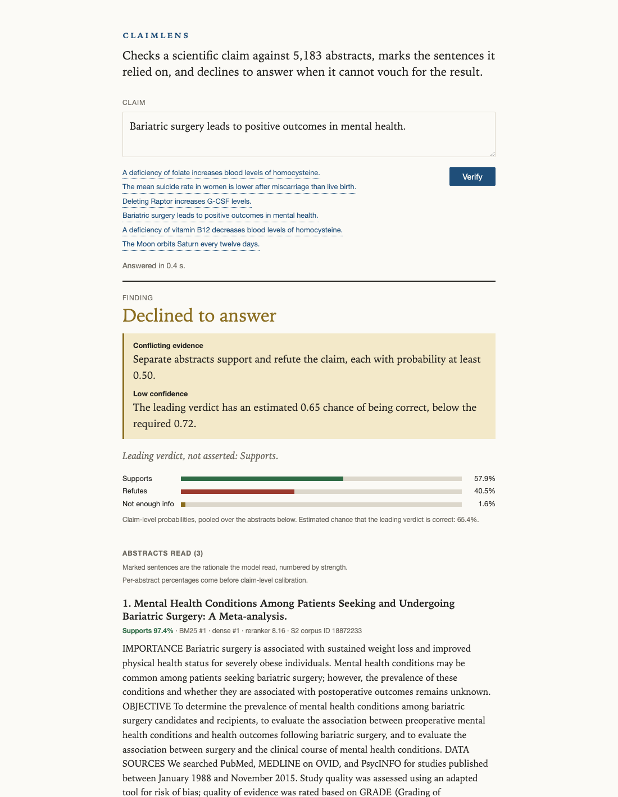
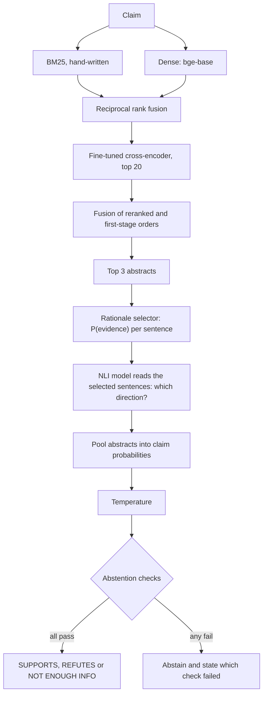
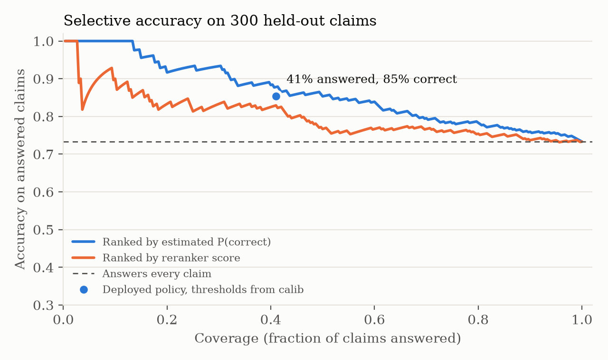
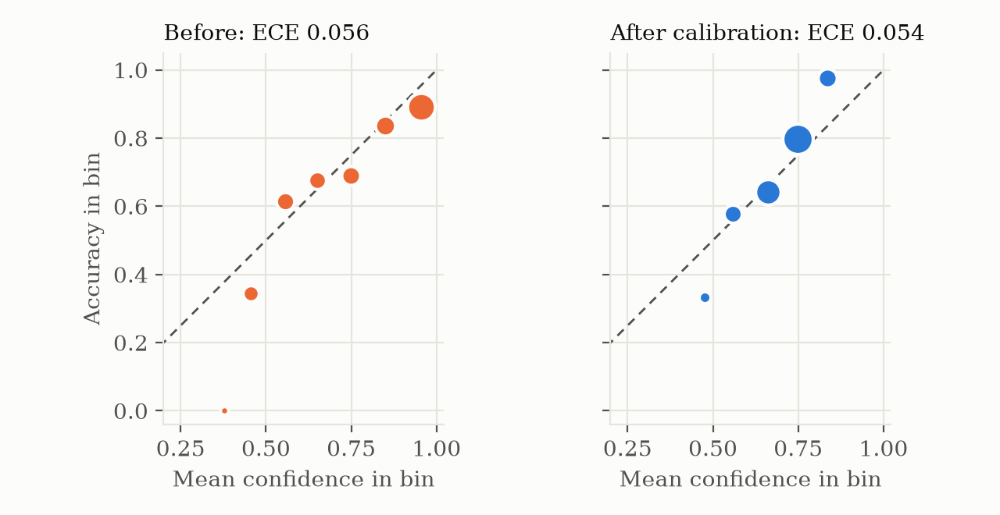

# claimlens

[](https://github.com/matejpopovski/claimlens/actions/workflows/ci.yml)

Give claimlens a scientific claim and it searches 5,183 biomedical abstracts, marks the
sentences that bear on the claim, and answers SUPPORTS, REFUTES or NOT ENOUGH INFO. When it
cannot vouch for an answer it says so, and says why.



*Captured from the running service. Abstracts that support and refute the claim are both on
the page, so the system withholds a verdict and reports which checks failed.*

On 300 held-out SciFact claims that no tuning step ever read:

| | Result | Comparison |
|---|---|---|
| Retrieval nDCG@10 | 0.772 | hand-written BM25 baseline 0.671 |
| Verdict macro-F1, answering everything | 0.720 (95% CI 0.667 to 0.772) | same system with stock weights 0.633 |
| Accuracy on the claims it chose to answer | 85.4% at 41% coverage | 73.3% when answering everything |
| Decisive answers once the cited evidence is removed | 5.9% of claims | 48.4% without abstention |

The last row is the reason this project exists. A claim verifier that answers everything will
keep asserting things after its evidence is gone. This one mostly stops.

Two results fall short, and both are covered [below](#what-fell-short). Calibration did not
reduce ECE on held-out data, and the official SciFact scores are behind VerT5erini.

## Which data each number comes from

SciFact and BEIR look like two evaluations but are one. BEIR's corpus is the SciFact corpus,
and its 300 test queries are exactly the 300 SciFact dev claims. SciFact's own test labels are
unreleased, so those dev claims are the only labelled held-out set available. Everything was
split around that fact:

| Split | Claims | Source | Used for |
|---|---|---|---|
| fit | 566 | SciFact train | Fine-tuning |
| val | 121 | SciFact train | Epoch selection, retrieval and verdict settings |
| calib | 122 | SciFact train | Temperature, confidence model, abstention thresholds |
| held-out test | 300 | SciFact dev, also BEIR test | `scripts/final_eval.py`, run once |

Fit, val and calib share no cited abstract, because SciFact negations reuse the abstract of
their source claim and a random split would leak it. The `cross_validation` folds shipped with
SciFact mix train and dev claims, so they are never read. `load_holdout` raises unless a flag
is passed at the call site, and `final_eval.py` refuses to run while a manifest exists in
`results/final`. That manifest records the commit, configuration and weight hashes of the run.

Two evaluations then read the same claims differently:

- **Retrieval** uses BEIR's qrels, which list every abstract a claim cited, including abstracts
  with no evidence for it.
- **Verdicts** use SciFact's annotations, which list only abstracts with evidence. Claim-level
  macro-F1 is this project's own measure and covers all three labels with every claim answered.
  The official SciFact scores are computed exactly as the leaderboard computes them.

## How a claim is judged



One abstract with real evidence settles a claim however many others are silent, so the decisive
labels pool by maximum over abstracts and NOT ENOUGH INFO by minimum.

NOT ENOUGH INFO and abstention are different outcomes. The first is a finding: related abstracts
were read and do not bear on the claim. The second is a refusal, with three possible reasons:

- **Low confidence.** The estimated chance of being correct is under the threshold.
- **Conflicting evidence.** One abstract supports and another refutes, each at 0.50 or more.
- **Weak retrieval.** The best reranker score is below what claims with a retrievable cited
  abstract normally reach, so the corpus may simply not cover the claim.

## Decisions the data forced

Three designs were changed by measurement on the validation split.

**One model could not do both jobs.** The first design used one fine-tuned NLI model to find
rationales and to judge them. Claim macro-F1 on val stalled at 0.660. A stage-by-stage diagnosis
pointed at the cause: retrieval and sentence selection were fine, but given the *gold* rationale
the model still answered NOT ENOUGH INFO on 31 of 78 abstracts, because that class had to absorb
5,353 near-miss training sentences. Splitting the question fixed it. A selector now decides
whether a sentence is evidence, and the NLI model, trained on a balanced set, decides which way
it points. Val macro-F1 rose to 0.746. The evidence is kept in `results/one_model_design`.

**Hybrid retrieval was not automatically better.** On val, dense retrieval alone (nDCG@10 0.755)
beat equal-weight fusion with BM25 (0.731), so fusion had to weight the dense list more heavily.
A stock MS MARCO cross-encoder then made ranking worse (0.692 against 0.759 for fusion alone). The
reranker only earned its place after fine-tuning on SciFact with hard negatives taken from fusion.

**Top-class probability was a poor measure of confidence.** The natural abstention signal barely
separated right from wrong on the calibration split, largely because REFUTES predictions are
right far less often than SUPPORTS at the same probability. A four-parameter logistic model over
the probability and the predicted class estimates P(correct) instead. It cannot change a
predicted label, so no F1 depends on it. A second idea, using disagreement between the NLI model
and the selector, was tested on the same splits and dropped because it carried no signal.

## Results

All figures are from `results/final`, on an Apple M3 Max, for the 300 held-out claims.

### Retrieval

| Stage | nDCG@10 | Recall@10 | Recall@100 | MRR@10 |
|---|---:|---:|---:|---:|
| BM25, hand-written | 0.671 | 0.782 | 0.898 | 0.641 |
| Dense, bge-base | 0.741 | 0.876 | 0.970 | 0.704 |
| RRF of both | 0.749 | 0.888 | 0.979 | 0.710 |
| RRF, stock cross-encoder | 0.715 | 0.874 | 0.979 | 0.673 |
| RRF, fine-tuned cross-encoder | 0.772 | 0.905 | 0.979 | 0.732 |
| Full stack, with final fusion | 0.772 | 0.899 | 0.979 | 0.734 |

The full stack gains 0.101 nDCG@10 over BM25 (paired 95% CI 0.066 to 0.134) and 0.030 over dense
alone (0.011 to 0.050). BEIR reports 0.665 for BM25 and 0.688 for BM25 with a cross-encoder on
these queries. Those models were not trained on SciFact and the reranker here was, so that gap
measures domain fine-tuning as much as architecture.

Pooled over abstracts with annotated evidence, recall is 90.9% at 3 and 95.2% at 5. VerT5erini
reports 86.12 and 89.95 for its T5 reranker on the same claims.

### Verdicts

Claim-level, every claim answered:

| System | Macro-F1 | 95% CI | SUPPORTS | REFUTES | NOT ENOUGH INFO |
|---|---:|---:|---:|---:|---:|
| claimlens, fine-tuned | 0.720 | 0.667 to 0.772 | 0.797 | 0.656 | 0.706 |
| Same pipeline, stock weights | 0.633 | 0.573 to 0.688 | | | |
| Majority class | 0.195 | | | | |

Official SciFact F1 on the dev claims, against the only comparable published figures, which are
VerT5erini's dev-set tables (Tables 9 and 10):

| Metric | claimlens | Stock weights | VeriSci | VerT5erini (BM25) | VerT5erini (T5) |
|---|---:|---:|---:|---:|---:|
| Abstract, label only | 57.6 | 56.0 | 51.03 | 65.98 | 65.07 |
| Abstract, label and rationale | 50.7 | 50.7 | 48.45 | 62.4 | 61.72 |
| Sentence, selection only | 41.9 | 34.3 | 47.69 | 59.97 | 60.87 |
| Sentence, selection and label | 38.6 | 29.8 | 42.62 | 56.62 | 57.1 |

Two checks support the comparison. Oracle recall at 3 here comes out at exactly 97.61,
VerT5erini's oracle figure, which confirms the same claims and the same definition. And the
evaluator matched
the official SciFact `eval.py` with a largest difference of 0.0 across 200 randomised trials.
The main tables of the SciFact and MultiVerS papers use the unreleased test labels, so they are
not listed here. Fine-tuning's clearest effect shows at sentence level and in claim-level
macro-F1. On abstract-level scores it barely separates from stock weights.

### Abstention



The 0.80 target and all thresholds were fixed on the calibration split before the test run.
The policy answered 123 of 300 claims at 85.4% accuracy (95% CI 78.9% to 91.1%), against the
73.3% of answering everything. Among the 70 answers that were SUPPORTS or REFUTES, 92.9% were
right. Coverage is the cost: nearly three in five claims get no answer. On the calibration split
the full policy reached 78.7%, so the held-out figure is better than the fit predicted, and the
width of its interval is the honest guide to what to expect.

**Evidence withheld.** SciFact is a closed corpus, so ordinary accuracy cannot show what happens
when the evidence is simply absent. For the 188 claims with annotated evidence, every cited
abstract was removed from the ranking and the claim was run again. Without abstention the system
still said SUPPORTS or REFUTES on 91 claims. With it, 11 remained (5.9%), and 156 claims were
declined. Uncited abstracts can legitimately bear on a claim, so this is an upper bound on the
harm and not an exact count.

### Calibration

| Confidence | ECE (10 bins) | 95% CI | Mean confidence | NLL | Brier |
|---|---:|---:|---:|---:|---:|
| Pooled scores, uncalibrated | 0.056 | 0.038 to 0.110 | 0.767 | 0.694 | 0.382 |
| Temperature (T = 1.76) | 0.089 | 0.060 to 0.137 | 0.651 | 0.688 | 0.392 |
| Confidence model, used by the policy | 0.054 | 0.038 to 0.107 | 0.702 | | |

Accuracy over these claims is 0.733. The intervals overlap, and that is the finding. See below.



## What fell short

**Calibration did not improve ECE.** The uncalibrated pooled scores were already reasonable
(0.056), temperature scaling made them worse (0.089), and the confidence model only returned to
the starting point (0.054). The temperature was fitted on 122 claims where accuracy happened to be
lower than on the test set, and the same fit on val gives a noticeably smaller value, so it
overshot. NLL improved slightly, Brier got worse, and neither moved meaningfully. Thresholding
worked. A claim that the numbers are now better calibrated would not be supported.

**The confidence model did not beat temperature at ranking.** Area under the precision-coverage
curve is 0.859 with it and 0.866 with temperature-scaled probability, so its advantage on the
validation and calibration splits did not carry over. Both beat ranking by reranker score (0.798).

**The official scores are behind VerT5erini.** Abstract-level F1 is 57.6 against 65.98, with
precision of 72.5 and recall of 47.8. Sentence-level selection is below VeriSci as well as
VerT5erini. Even when given gold abstracts, label-only F1 is 65.2 (precision 92.9, recall 50.2)
against 77.47 for VeriSci and 85.27 for VerT5erini. The system is quiet more than it is wrong: on
val, of 78 gold abstracts 30 were labelled NOT ENOUGH INFO and only 3 went the wrong way, because
P(evidence) came in low (`results/abstract_label_check.json`). The obvious repair was tested on
tuning data and failed, since applying the claim-level NOT ENOUGH INFO bias to abstract labels
lowered val abstract F1 from 0.599 to 0.557. The selector itself would need to improve.

**The NLI model is behind on gold rationales too.** With gold rationales its macro-F1 is 79.1, up
from 70.9 stock, where VerT5erini's Table 8 implies 80.19 for the VeriSci label model and 88.16
for T5. The set here has 114 NOT ENOUGH INFO abstracts and their dev statistics list 112 claims,
so this comparison is close but not identical.

**Final fusion added nothing on the test set.** It beat plain reranking on val (0.770 against
0.748) but tied on held-out claims, and the paired difference is 0.000 (-0.016 to 0.015). It stays
in the pipeline because it was frozen before the test run, not because it is known to help.

## Running it

`Python 3.12` and [uv](https://docs.astral.sh/uv/). Tests need no data and no downloads:

```
uv sync --frozen
uv run --frozen pytest -q
```

That runs the fast suite on tiny random transformers built on disk. Seven further tests need real
weights and are **skipped by default and in CI**. Run them after fetching models with
`uv run --frozen pytest -m models`.

To try the service, download the data and models, build the index, and start it. Stock weights
work with no training, and the page says plainly that no reported metric applies to them:

```
uv run --frozen python scripts/download_data.py
uv run --frozen python scripts/fetch_models.py --only bge-base ms-marco-minilm deberta-nli
uv run --frozen python scripts/encode_corpus.py --encoders bge-base
uv run --frozen python -m claimlens.service --weights stock
```

Then open <http://127.0.0.1:45411>. The API is `POST /api/verify` with `{"claim": "..."}`.

**The fine-tuned weights are not in this repository**, because each is far over GitHub's file
limits, and they are not hosted elsewhere. They are rebuilt from public sources by:

```
scripts/reproduce.sh
```

That script chains the same commands used for the published numbers, writing to `runs/repro`
so `results/final` stays untouched. As a whole it has not been run end to end, because it ends in
a second read of the test set. Each step was run individually to produce `results/`, and the
exact weight hashes are in `results/final/manifest.json`. Seeds are fixed, but GPU kernels are not
bit-exact across machines, so expect close numbers and not identical ones. The reranker was
fine-tuned on CPU, and the selector and NLI model on Apple MPS.

Other commands: `scripts/crosscheck_metrics.py` compares the evaluators with reference
implementations, `scripts/make_figures.py` redraws the charts, and
`scripts/capture_screenshots.py` retakes the screenshots through a real browser against a running
service, failing if evidence or abstention reasons are missing from the page.

A test scans this README and fails if a decimal in the prose does not trace to a committed
file in `results/`.

## Sources and licences

SciFact was confirmed at its source: claims and annotations are CC BY 4.0, and abstracts come
from S2ORC under ODC-By 1.0, per the dataset's own
[LICENSE.md](https://github.com/allenai/scifact/blob/master/LICENSE.md). The BEIR paper lists
SciFact as CC BY-NC 2.0, which does not match. No data is committed, and the download script
verifies pinned hashes.

| Model | Role | Licence |
|---|---|---|
| `BAAI/bge-base-en-v1.5` | Dense retrieval | MIT |
| `cross-encoder/ms-marco-MiniLM-L6-v2` | Base of the reranker and selector | Apache-2.0 |
| `MoritzLaurer/DeBERTa-v3-base-mnli-fever-anli` | Base of the NLI model | MIT |

Licences were read from the model cards at pinned revisions, recorded in
`results/provenance.json`. No LLM API or key is involved. Code is MIT.

Published figures are in `results/published_baselines.json`, copied from Thakur et al., BEIR
([arXiv:2104.08663](https://arxiv.org/abs/2104.08663)), and Pradeep et al., VerT5erini
([arXiv:2010.11930](https://arxiv.org/abs/2010.11930)). The task and data are from Wadden et al.,
Fact or Fiction ([arXiv:2004.14974](https://arxiv.org/abs/2004.14974)).

## Limitations

- The corpus is fixed at 5,183 abstracts, so a verdict describes those abstracts and not the
  literature. A SUPPORTS means these abstracts appear to support the claim, and it is not medical
  or scientific advice.
- At the chosen threshold, 59% of claims get no answer. That is the price of the 85.4% figure, and
  a different target gives a different trade.
- All thresholds rest on 122 calibration claims and the verdict settings on 121 validation claims.
  Several differences reported above are within the noise of samples this size, and the intervals
  shown are bootstrap intervals over claims, which do not capture this tuning noise.
- The numbers measure SciFact's claim style: atomic claims written by annotators from citations.
  Real-world claims are messier, and no such evaluation has been run.
- Only abstracts are read, in English, as pre-split sentences. A claim settled by a full-text table
  or figure will come back NOT ENOUGH INFO or abstained. Pasting new abstracts in at runtime is not
  supported.
- Retrieval gives no notion of study quality, so a weak study can outvote a strong one.
- Service latency and throughput were not benchmarked, so none are claimed.
